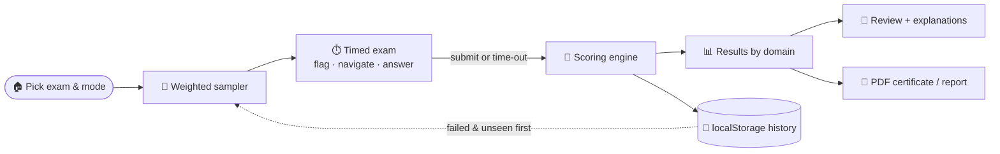

<div align="center">



### Practice like it is the real exam: timed, scored, reviewed.

[](https://portfolio-jaime.github.io/cert-exam-simulator/)
[](https://github.com/Portfolio-jaime/cert-exam-simulator/actions/workflows/deploy.yml)


**[🚀 Open the app](https://portfolio-jaime.github.io/cert-exam-simulator/)** ·
**[📚 Docs](#-documentation)** ·
**[🧭 Study plans](docs/STUDY-PLANS.md)** ·
**[🧮 Scoring](docs/SCORING.md)** ·
**[🇪🇸 Resumen](#-resumen-en-español)**

</div>

---

## ✨ Features

| | Feature | Details |
|---|---|---|
| ⏱️ | **Real exam conditions** | Countdown timer, auto-submit at zero, no feedback until you finish, flag questions, review screen before submitting. |
| ☑️ | **Single & multi-select** | "Select TWO / THREE" items with all-or-nothing credit, exactly like the real thing. |
| 🎯 | **Weighted sampling** | Questions follow each exam's official domain weights; failed and unseen questions are prioritised. |
| 🧩 | **Scenario exams** | Full simulation draws 4 random scenarios out of 6 and groups their questions together. |
| 📊 | **Scores that mean something** | Estimated scaled score (100–1000, pass ≥ 720), per-domain breakdown and weakest-domain hint. |
| 🧾 | **PDF certificate / report** | Pass a full simulation → practice certificate. Any other attempt → results report. Unique ID, bilingual. |
| 🌐 | **EN / ES switch** | UI, scenarios and Claude exam questions in both languages, switchable at any time, even mid-exam. |
| 🗓️ | **Study plans + countdown** | Day-by-day checklist per exam, days-to-go counter, readiness bars from your history. |
| 📈 | **History & review** | Trend chart, per-attempt review with an explanation for every distractor, "review missed" mode. |
| 🔒 | **Private by design** | 100 % static. No accounts, no server, no tracking: everything lives in your browser's `localStorage`. |

## 🎓 Exams included

| Exam | Code | Questions | Format | Domains |
|---|---|---:|---|---|
|  **Solutions Architect – Associate** | `SAA-C03` | 66 | 65 items · 130 min · 15 unscored | Secure 30 % · Resilient 26 % · Performance 24 % · Cost 20 % |
|  **Claude Certified Architect – Foundations** | `CCAR-F` | 72 (EN + ES) | 60 items · 120 min · 4 of 6 scenarios | Agentic 27 % · Tools & MCP 18 % · Claude Code 20 % · Prompting 20 % · Context 15 % |

> [!NOTE]
> All questions are **original practice items** written from the public exam guides. No exam dumps, no copied content.

## 🔄 How a session works



## 🚀 Quick start

```bash
git clone https://github.com/Portfolio-jaime/cert-exam-simulator.git
cd cert-exam-simulator
npm ci
npm run dev          # http://localhost:5173
```

| Command | What it does |
|---|---|
| `npm run dev` | Start the dev server |
| `npm test` | Unit tests (Vitest) |
| `npm run validate:bank` | Validate every question file (schema, ids, answers, translations) |
| `npm run build` | Typecheck and build to `dist/` |
| `npm run preview` | Serve the production build |

> [!TIP]
> Requires **Node 24**. Deployment to GitHub Pages is automatic on every push to `main`.

## 🗂️ Project structure

```
├── src/
│   ├── exams.ts          # exam definitions: domains, weights, scenarios, timings
│   ├── exam/             # engine · scoring · sampler (pure logic, fully tested)
│   ├── ui/               # screens: home · exam · results · review · history · plan
│   ├── pdf/              # certificate / report generator (jsPDF)
│   ├── i18n.ts           # EN/ES helpers
│   ├── plans.ts          # study plans and resources
│   └── store.ts          # localStorage persistence
├── data/questions/       # question bank, one folder per exam
│   ├── saa/              # secure · resilient · performance · cost
│   └── ccaf/             # s1 … s6 (one file per scenario)
├── scripts/validate-bank.ts
├── tests/                # 23 unit tests
└── docs/                 # full documentation
```

## 📚 Documentation

| Doc | Read it for |
|---|---|
| [🏗️ Architecture](docs/ARCHITECTURE.md) | Modules, data flow, state, design decisions |
| [🧮 Scoring](docs/SCORING.md) | Scaled score formula, multi-select rules, certificate eligibility |
| [🧱 Question bank](docs/QUESTION-BANK.md) | Schema, bilingual fields, how to add questions, validator rules |
| [🧭 Study plans](docs/STUDY-PLANS.md) | The day-by-day plans and how to adapt them |
| [🛠️ Development](docs/DEVELOPMENT.md) | Setup, testing, CI/CD and Pages deployment, adding a new exam |

## 🗺️ Roadmap

- [x] Timed simulations with single and multi-select questions
- [x] Per-domain scoring, history and review
- [x] PDF certificate / report
- [x] Two exams, EN/ES, study plans
- [ ] Grow both banks to 200+ questions
- [ ] English translation of the AWS bank
- [ ] Export / import of history
- [ ] More exams (SysOps, Developer Associate)

## ⚠️ Disclaimer

This is an independent, personal study tool. It is **not affiliated with, endorsed by, or sponsored by AWS or Anthropic**. Scores are estimates, and the PDF is a *practice* document, not a certification or an official result.

---

## 🇪🇸 Resumen en español

<details>
<summary><b>Ver resumen</b></summary>

**Cert Exam Simulator** es un simulador de exámenes de certificación que corre 100 % en el navegador (sin servidor ni cuentas). Incluye:

- Simulacros con **temporizador real**, preguntas de selección única y **múltiple (todo o nada)**, marcadores y pantalla de revisión.
- **Puntaje estimado** de 100 a 1000 (aprueba con ≥ 720) y nota **por dominio**.
- **Certificado o informe en PDF**, historial con tendencia y repaso de las preguntas falladas.
- **Dos exámenes**: AWS Solutions Architect Associate (SAA-C03) y Claude Certified Architect – Foundations (CCAR-F), este último en **español e inglés**.
- **Plan de estudio** día a día con cuenta regresiva y barras de preparación por dominio.

**Uso rápido:** `npm ci && npm run dev`. La documentación completa está en [`docs/`](docs/).

</details>
