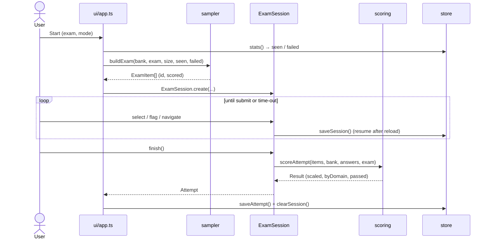

# 🏗️ Architecture

Cert Exam Simulator is a **static single-page app** (Vite + TypeScript, no framework, no backend). All logic runs in the browser and all state lives in `localStorage`.

## Module map

```mermaid
flowchart TB
    subgraph UI["ui/ (rendering only)"]
        APP[app.ts<br/>router + screens]
        DOM[dom.ts<br/>h&#40;&#41; helper]
    end
    subgraph CORE["exam/ (pure logic)"]
        ENG[engine.ts<br/>ExamSession]
        SAMP[sampler.ts<br/>buildExam]
        SCORE[scoring.ts<br/>scoreAttempt]
    end
    EXAMS[exams.ts<br/>exam definitions]
    BANK[bank.ts<br/>loads data/questions]
    STORE[store.ts<br/>localStorage]
    I18N[i18n.ts<br/>EN / ES]
    PLANS[plans.ts<br/>study plans]
    PDF[pdf/certificate.ts<br/>jsPDF]

    APP --> ENG & SAMP & STORE & PDF & I18N & PLANS & BANK
    ENG --> SCORE
    SAMP --> EXAMS
    SCORE --> EXAMS
    PDF --> EXAMS
    BANK -.->|import.meta.glob| JSON[(data/questions/*/*.json)]
    STORE -.-> LS[(localStorage)]
```

| Module | Responsibility |
|---|---|
| `exams.ts` | **Single source of truth** for each exam: domains and weights, scenarios, timings, pass mark, exam date. Adding an exam starts here. |
| `exam/sampler.ts` | Builds an exam: weighted allocation per domain, priority to failed/unseen questions, scenario mode, seeded shuffling. |
| `exam/engine.ts` | `ExamSession`: answers, flags, navigation, timer maths, `finish()` that produces an `Attempt`. |
| `exam/scoring.ts` | Correctness rules, scaled score, per-domain results, certificate eligibility. |
| `store.ts` | History, in-progress session, language, selected exam, study-plan progress. Falls back to memory if storage is blocked. |
| `bank.ts` | Loads every `data/questions/<exam>/*.json` at build time with `import.meta.glob`; the folder name is the exam id. |
| `i18n.ts` | `tr(lang, es, en)` for UI strings, `view()` / `scenarioView()` for localized question content. |
| `pdf/certificate.ts` | Generates the certificate or report with jsPDF (loaded lazily, so it is not in the main bundle). |
| `ui/app.ts` | Hash router (`#/`, `#/exam`, `#/results/<id>`, `#/review/<id>`, `#/history`, `#/plan`) and all screens. |

## Data flow of one attempt

## Key design decisions

- **Pure core, thin UI.** `exam/*` has no DOM access, so it is tested with plain Vitest.
- **Data-driven exams.** Domains, weights, timings and scenarios come from `exams.ts`; nothing else hard-codes an exam.
- **Reproducible sampling.** The sampler takes a seed (`mulberry32`), so tests are deterministic and a session can be rebuilt.
- **Resume after reload.** The running session is persisted on every interaction; the clock is derived from `startedAt`, so a reload never "pauses" the timer.
- **Graceful storage.** Every read/write is wrapped in `try/catch` and mirrored in memory; the app still works in private windows.
- **Lazy PDF.** `jspdf` is dynamically imported, keeping the first load small.
- **Legacy-safe history.** Attempts saved before multi-exam support default to `saa` when read.

## Persistence keys

| Key | Content |
|---|---|
| `saa.history.v1` | All finished attempts |
| `saa.session.v1` | The attempt in progress |
| `saa.name.v1` | Name printed on the PDF |
| `saa.lang.v1` | `es` or `en` |
| `saa.exam.v1` | Selected exam id |
| `saa.plan.v1` | Completed study-plan tasks |

> [!NOTE]
> Clearing site data wipes history and plan progress. There is no server copy.
